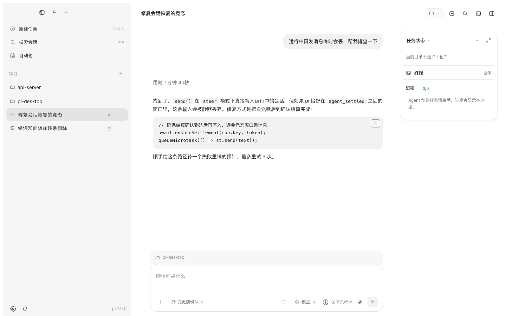
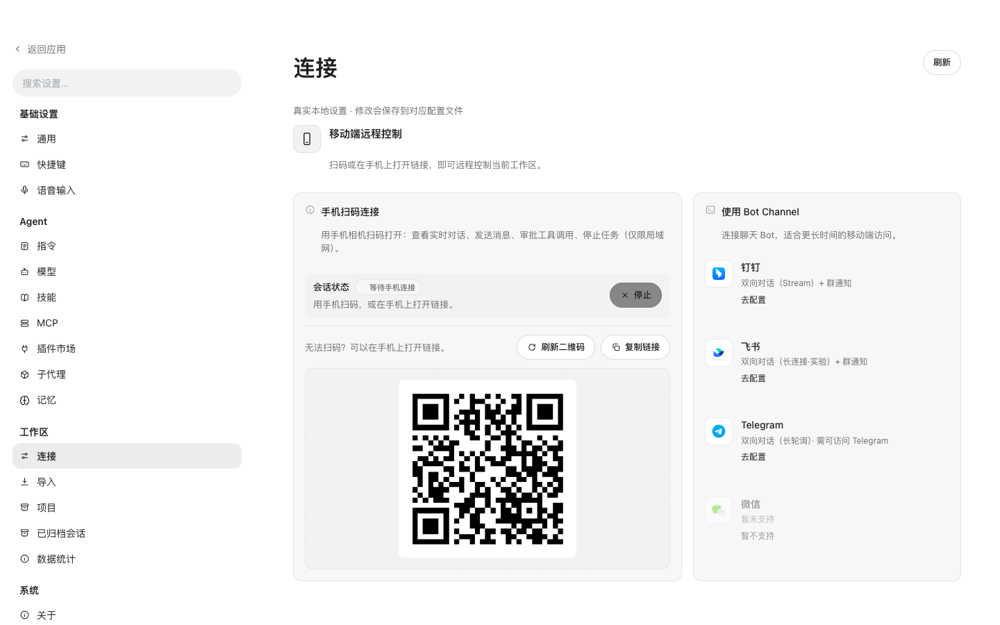

# PI Desktop

**English** | [简体中文](./README.zh-CN.md)

[](https://github.com/xiaoliu10/pi-desktop/releases/latest)
[](./LICENSE)
[](https://www.electronjs.org/)
[](https://www.npmjs.com/package/@earendil-works/pi-coding-agent)

**The desktop workbench for the [pi coding agent](https://www.npmjs.com/package/@earendil-works/pi-coding-agent) — see every step, approve every action, and stay in charge.**

PI Desktop wraps your local **pi CLI** in a real desktop app: streaming conversations with the full agent process on display (thinking, tool calls, subagents, plan progress), line-level change review, a built-in terminal, and remote control from your phone. Bring your own models — authentication stays inside pi, never in the frontend.

| Chat with full process disclosure | Remote control from your phone |
| --- | --- |
|  |  |

## Why PI Desktop

- **Nothing hidden.** Thinking streams, tool calls, subagent activity, plan checklists, even context compaction — everything the agent does renders as a live timeline, with elapsed-time badges and code blocks you can copy with one click.
- **Supervised autonomy.** Every file edit and command asks before it runs (allow once / always for this session / deny), switchable per task to auto-edit or full access. The Review panel shows the net workspace diff against Git HEAD — it never claims another session's changes as its own.
- **Self-healing runs.** Lost settlement confirmations and "fake running" states — the classic ways agent UIs hang forever — are detected and recovered automatically, with in-chat error rendering instead of dead-end banners.
- **Stay in flow.** Edit a sent message while the task is running (it becomes a queued follow-up or an immediate steer), queue follow-ups, interrupt anytime, and keep several sessions alive across projects.
- **Away from desk.** Scan a QR code to drive the current workspace from your phone on the LAN — watch the live conversation, approve tool calls, stop tasks. Or connect a Bot channel (DingTalk / Feishu / Telegram / WeChat notifications) for longer sessions with group notifications.
- **A workbench, not a chat box.** Multi-tab terminal (node-pty + xterm) that survives in the background, plan mode with a live checklist viewer, `@` file references, image attachments, and optional voice input.
- **Bring your own model.** pi owns provider config and auth: OpenAI, Anthropic, subscription login, or any OpenAI-compatible endpoint (DeepSeek, Ollama, LM Studio, vLLM, gateways). Switch models mid-session; separate ASR models for voice.
- **Bilingual UI.** Chinese and English, switchable in settings.

## Quick start

> Requirements: [pi CLI](https://www.npmjs.com/package/@earendil-works/pi-coding-agent) installed and verified in a terminal (auth and models are managed by pi itself), Node.js ≥ 20 if building from source.

**Download** the installer for your platform from [Releases](https://github.com/xiaoliu10/pi-desktop/releases/latest):

- macOS (Apple Silicon): `PI.Desktop-<version>-arm64.dmg`
- Windows: `PI.Desktop.Setup.<version>.exe`

Or run from source:

```bash
pnpm install
pnpm dev        # Vite HMR + Electron
# or
pnpm build && pnpm start
```

> If the Electron binary wasn't downloaded during `pnpm install` (pnpm 10+ blocks build scripts by default), run `pnpm rebuild electron`.

### First run

1. Start PI Desktop — your existing CLI sessions appear on the left automatically, grouped by project.
2. Browse any session read-only, then click **Continue in Desktop** to create a continuation copy; the CLI original stays untouched.
3. Start a new session, pick the project trust and tool permission mode, choose a model, and send your first task.

Verified against pi **0.85.1 up to (not including) 1.3.0 on macOS and Windows** — the bundled runtime ships 1.2.0. Unknown versions stay readable but are disabled for execution; the app falls back to the bundled runtime.

## How it works

```
┌─────────────── PI Desktop (Electron) ───────────────┐
│  Renderer   React UI: chat · review · terminal ·    │
│             plans · plugins · settings · remote     │
├────────────── contextBridge (typed IPC) ────────────┤
│  Main        session discovery · self-healing RPC   │
│              watchdog · permissions · safeStorage   │
└──────────────────────┬──────────────────────────────┘
                       │ pi --mode rpc
┌──────────────────────▼──────────────────────────────┐
│  pi CLI: agent loop · tools · providers · auth      │
│  (sessions, models and skills stay in pi)           │
└─────────────────────────────────────────────────────┘
```

PI Desktop drives your local pi through its RPC mode. CLI sessions are discovered on disk and followed live; nothing is imported or duplicated. Desktop settings store only paths and UI preferences — API keys and subscriptions never leave pi.

## Feature tour

- **CLI sessions appear automatically** — grouped by cwd, following on-disk history; continuation copies keep the original read-only.
- **Per-action tool confirmation** — a dedicated pi extension implements allow / deny / cancel dialogs with session-wide grants; permission modes switchable in the composer (this is app-level confirmation, not an OS sandbox).
- **Real review** — the Review panel aggregates the net diff of file changes within a session (line-level), so you see exactly what changed.
- **Integrated terminal** — a multi-tab terminal panel toggled from the top bar; sessions stay alive in the background.
- **Plan mode** — the plan document and checklist progress render live while the agent works, with snapshot recall and one-click "execute plan".
- **Subagents** — define subagents locally; they run as standalone pi sessions with live activity cards in the conversation.
- **MCP** — stdio and Streamable HTTP servers register tools into pi, managed from the settings UI.
- **Plugins & skills marketplace** — discover, install and manage pi resources (commands, skills, extensions) from a unified page.
- **Memory** — optional long-term/project memory via the pi-memory extension, browsable and editable in settings.
- **Notifications with dedup** — queue, steering and settlement events surface once, never spam.
- **Voice input** — cloud ASR (OpenAI transcriptions endpoint or chat-multimodal gateways, with 404 auto-fallback), transcription appended to the composer, never auto-sent. See [Voice input setup](./docs/voice-input.md) for configuration details.
- **Bilingual UI & theming** — Chinese/English switchable, light/dark themes, font choice.

## 📅 Recent releases

<table>
<thead><tr><th>Version</th><th>Highlights</th></tr></thead>
<tbody>
<tr><td><strong>0.1.38</strong></td><td><ul><li><strong>Local file links work again</strong>: click an assistant-delivered <code>file://</code> link to open a document in its default app or reveal it in Finder; executables and network shares stay blocked.</li><li><strong>HTML files render in the workbench</strong> with a render/source toggle (sandboxed, no same-origin access).</li><li><strong>The "compaction in progress" rejection no longer leaves a permanent red banner</strong>: it appears inline and clears automatically.</li></ul></td></tr>
<tr><td><strong>0.1.37</strong></td><td><ul><li><strong>Bundled pi upgraded to 1.4.0</strong>: includes upstream compaction, tool recovery, and retry fixes; compatible local pi 1.4.x can be selected automatically on macOS/Linux. Windows local npm CLI support remains pending.</li><li><strong>About shows the real Desktop version</strong> instead of the old 0.1.0-desktop placeholder.</li></ul></td></tr>
<tr><td><strong>0.1.36</strong></td><td><ul><li><strong>Cross-session handoff (new desktop_handoff tool)</strong>: hand findings to the session responsible for another project — reuses that project's most recent unarchived session, starts immediately when idle, queues behind a busy turn, reconnects first when disconnected; project memory/permissions stay isolated. No more shuttling findings via temp files.</li><li><strong>Fixed full-app white-screen crash when a new version is detected</strong>: the update banner misused process.platform (main-process-only) and crashed the renderer on render; now uses browser platform detection, plus per-window navigation forensics so the rare "window full of source code" issue becomes diagnosable.</li></ul></td></tr>
<tr><td><strong>0.1.35</strong></td><td><ul><li><strong>One-click model list fetch for custom providers</strong>: fill in Base URL and API key under Settings → Models, click "Fetch model list" to pull the provider's /models and auto-fill the dropdown — no more typing model IDs by hand (non-chat models like embeddings are filtered out).</li><li><strong>File paths in chat are clickable</strong>: click a file path or local Markdown link in a message to view the full file in the workbench, with "file:line" jump support.</li><li><strong>/new command in the composer</strong>: starts a new task; trailing text becomes its first draft and attachments carry over.</li><li><strong>Web links no longer reset the whole app to home</strong>: external links now open in the system browser.</li><li><strong>Marketplace search matches original package names</strong>: searching pi-lens no longer returns only forks.</li><li><strong>Retry banner no longer lingers after model output resumes</strong>; it returns if the failure recurs.</li><li><strong>Scheduled tasks no longer run twice in two sessions</strong>: duplicate creates are idempotently blocked, and concurrent tasks in one project queue into the same session serially.</li><li><strong>Switching models in one session no longer leaks to others</strong>: model drafts are scoped per session and the latest choice survives session eviction.</li><li><strong>IM channel manual-config form redesigned</strong>: vertical card layout, no more squeezed inputs, switches consistent with the rest of the app.</li></ul></td></tr>
<tr><td><strong>0.1.34</strong></td><td><ul><li><strong>Session list now appears in ~0.1s instead of ~7s</strong>: a persisted project→title metadata snapshot (~290KB) renders the sidebar immediately on launch; background verification only re-parses changed files, and full content loads on demand when a session opens.</li><li><strong>Timer stops promptly when a task ends</strong>: Desktop now verifies idleness with pi on the turn-end signal instead of relying solely on an easily-lost settlement event and waiting up to 120s.</li><li><strong>“Earlier messages” paging no longer snaps back</strong> in active large sessions: background refreshes used to reset the loaded window to the last 500 entries; they now preserve the expanded range while appending new tail messages.</li></ul></td></tr>
<tr><td><strong>0.1.33</strong></td><td><ul><li><strong>Fixed blank session history after restarting 0.1.32</strong>: the index worker's bootstrap files were packaged inside the app archive, which the OS cannot launch from — all session list/history reads timed out. Now unpacked at directory level with the message-channel semantics corrected; verified against the full production path.</li></ul></td></tr>
<tr><td><strong>0.1.32</strong></td><td><ul><li><strong>Architectural root cause of typing/mouse lag removed</strong>: session indexing (directory walk, session file read/parse, search, outline, subagent state recovery) used to run synchronously on the main thread — with a large directory the main thread was blocked and input/mouse spun. That work now happens in a separate process while the main process keeps only two bounded mirrors. On the same machine and real data (367 sessions / 1.1GB, largest single file 210MB): the cold full scan still happens, but <strong>max main-thread event-loop delay dropped from a full block to 7.5ms</strong>; one screen of the largest session history reads in 14ms; 200 sidebar metadata sync reads total 1ms.</li><li><strong>Every IPC call ran its business twice (since 0.1.30)</strong>: the unified entry did "run business → verify source → run business again", so every legal synchronous call ran twice (double main-process cost; writes could land twice), while slow-call timing only covered the first run and logs hid the real duration. Authorization now completes before any business runs, business runs exactly once, and all four return semantics are preserved.</li><li><strong>Source verification was bypassable by async calls (since 0.1.30)</strong>: the old entry returned early for Promise-returning handlers and never reached the verification line, so non-main-window async calls still got results and side effects. Invalid sources are now rejected before executing any business.</li><li><strong>Opening an external session no longer shows stale content</strong>: sessions started in the terminal and later continued in Desktop have two files; only "send" switched to the newer copy while "open" still read the original snapshot — so every open stopped where you left off and paging never showed later content. Open now resolves the newest copy or chain tip through the same read-only rule and shows it directly: no model start, no message sent, no session file rewritten. After an edit-and-resend on a connected session, history reads the actual continuation file and never jumps back to the old snapshot; drafts are kept, and when both sides have unsent content they are merged.</li><li><strong>Subagent "Working for / Took" timers are back</strong>: fixing the "490k hours" bug in 0.1.31 blanked the timestamps entirely, which removed the timer. Real start/end times from the main-process snapshot now fill them in: "Working for" while running, "Took" when finished; no valid time still means no timer — never a cache version or the current time.</li><li><strong>Subagent timers no longer inflated or missing</strong>: workflows passed the parent run start off as each child start (siblings off by tens of seconds); terminal orphans lost "Took". Each child now uses only its own verified clock, and ordinary async cards get their real start too.</li><li><strong>Less repeated session-index parsing</strong>: non-pi .jsonl files in the session directory are no longer re-read and re-parsed while unchanged (measured warm scan 449ms → 45ms).</li></ul></td></tr>
<tr><td><strong>0.1.31</strong></td><td><ul><li><strong>Chat images &amp; lightbox download fixed</strong>: the blob-URL era CSP allowed display but blocked reads — attachments showed broken images and downloads silently failed. Both paths now work (renderer-created blobs only; no network egress opened).</li><li><strong>“Working for 490k hours” fixed</strong>: subagent timers now use real message timestamps; missing timestamps show no timer.</li><li><strong>Live subagent transcript while running</strong>: no more “transcript unavailable”; failed reads keep what was already shown.</li><li><strong>Project rows no longer spin</strong>: running indicator back to session level; project rows keep the folder icon.</li><li><strong>No more duplicate “PI Desktop” in Launchpad</strong>: packaging leftovers are cleaned automatically.</li><li><strong>Lighter large-session refresh</strong>: history responses no longer re-send unconsumed tool-image base64 (measured IPC 48–57ms → ~1ms).</li></ul></td></tr>
<tr><td><strong>0.1.30</strong></td><td><ul><li><strong>Sidebar no longer looks idle while background subagents run</strong>: the session row keeps its busy indicator while the parent waits on subagents, and the project row also shows it when collapsed; it clears automatically when they finish.</li><li><strong>Subagent polling CPU spikes / typing lag fixed</strong>: each poll re-scanned the whole branch once per pinned subagent (measured 287ms/tick on a 117MB / 32k-entry session); now one scan + lookup brings it to 4ms.</li><li><strong>Progress indicator survives closing all windows and reopening</strong>.</li></ul></td></tr>
<tr><td><strong>0.1.29</strong></td><td><ul><li><strong>Typing lag fixed at six layers</strong>: p50 keystroke delay 241ms→29ms; streaming main-process CPU from 100% down to single digits (probe-driven layer-by-layer fixes)</li><li><strong>In-session full-text search + session map</strong>: global search gains an in-session section with jump-to-message; sidebar entry navigates long conversations turn by turn</li><li><strong>DingTalk bot fixed</strong>: startup race left it permanently silent — now auto-retries with full logs at ~/Library/Logs/PI Desktop/im-bot.log</li><li><strong>Task checklist fix</strong>: checklists no longer vanish when scrolled out of the render window; stronger guidance for the model to create them</li><li><strong>Built-in subagent retired</strong>: subagents now come exclusively from your installed extensions; settings page shows capability status</li></ul></td></tr>
</tbody>
</table>

> Only recent releases are listed here. See [CHANGELOG.md](./CHANGELOG.md) for the full history.

## Development

```bash
pnpm install
pnpm dev            # dev orchestration (Vite + tsc + Electron)
pnpm typecheck      # main + renderer
pnpm test           # vitest unit + browser tests
pnpm preview:ui     # pure-web UI preview (no Electron / model keys / user files)
```

Real process-isolation test run (no external model calls):

```bash
PI_TEST_EXECUTABLE=/opt/homebrew/bin/pi pnpm exec vitest run tests
```

Development docs under [`docs/`](./docs) are written in Chinese: [RPC protocol baseline](./docs/pi-protocol-baseline.md) · [Tool permission boundary](./docs/pi-permission-boundary.md) · [Settings implementation](./docs/settings-implementation.md) · [Phase 2 delivery & verification](./docs/pi-integration-verification.md).

## Differences from the reference project

The UI takes inspiration from [vastsa/PI-Desktop](https://github.com/vastsa/PI-Desktop) (LGPL-3.0, no code reused). That project pairs Electron with a Rust host core; PI Desktop is an independent, Node-only implementation focused on the pi CLI integration: a Node main process carries the host-core responsibilities, so there is no Rust toolchain to build.

## Contributing

Issues and PRs are welcome. Please open an issue to discuss the approach first; make sure `pnpm typecheck && pnpm test` passes before submitting.

## Acknowledgements

- [pi coding agent](https://www.npmjs.com/package/@earendil-works/pi-coding-agent) — the agent kernel this workbench drives
- Product shape and architecture ideas reference [vastsa/PI-Desktop](https://github.com/vastsa/PI-Desktop) (LGPL-3.0); no code was reused
- [Electron](https://www.electronjs.org/) · [React](https://react.dev/) · [Vite](https://vite.dev/) · [zustand](https://zustand.docs.pmnd.rs/) · [react-markdown](https://github.com/remarkjs/react-markdown) · [highlight.js](https://highlightjs.org/)

## License

Licensed under the [Apache License 2.0](./LICENSE).
