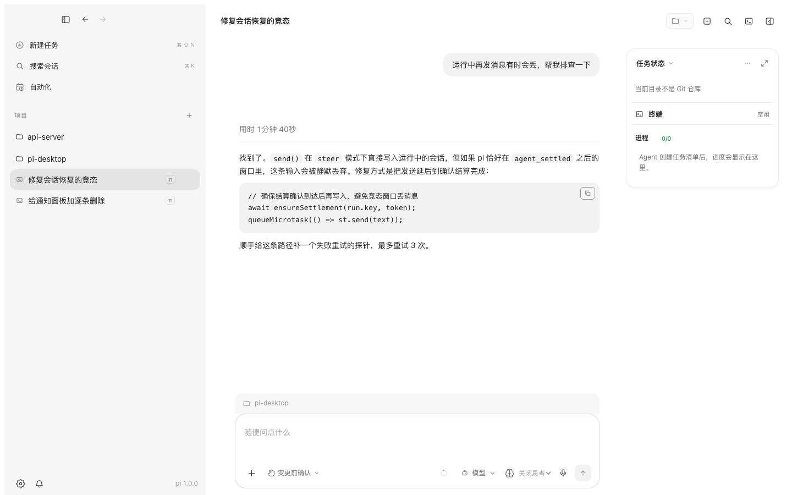
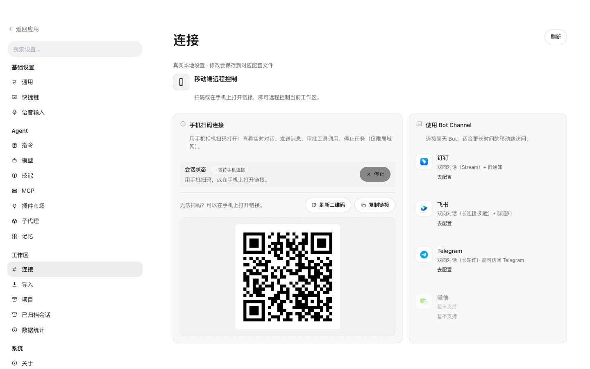

# PI Desktop

**English** | [简体中文](./README.zh-CN.md)

[](https://github.com/xiaoliu10/pi-desktop/releases/latest)
[](./LICENSE)
[](https://www.electronjs.org/)
[](https://www.npmjs.com/package/@earendil-works/pi-coding-agent)

**The desktop workbench for the [pi coding agent](https://www.npmjs.com/package/@earendil-works/pi-coding-agent) — see every step, approve every action, and stay in charge.**

PI Desktop wraps your local **pi CLI** in a real desktop app: streaming conversations with the full agent process on display (thinking, tool calls, subagents, plan progress), line-level change review, a built-in terminal, and remote control from your phone. Bring your own models — authentication stays inside pi, never in the frontend.

| Chat with full process disclosure | Remote control from your phone |
| --- | --- |
|  |  |

## Why PI Desktop

- **Nothing hidden.** Thinking streams, tool calls, subagent activity, plan checklists, even context compaction — everything the agent does renders as a live timeline, with elapsed-time badges and code blocks you can copy with one click.
- **Supervised autonomy.** Every file edit and command asks before it runs (allow once / always for this session / deny), switchable per task to auto-edit or full access. The Review panel shows the net workspace diff against Git HEAD — it never claims another session's changes as its own.
- **Self-healing runs.** Lost settlement confirmations and "fake running" states — the classic ways agent UIs hang forever — are detected and recovered automatically, with in-chat error rendering instead of dead-end banners.
- **Stay in flow.** Edit a sent message while the task is running (it becomes a queued follow-up or an immediate steer), queue follow-ups, interrupt anytime, and keep several sessions alive across projects.
- **Away from desk.** Scan a QR code to drive the current workspace from your phone on the LAN — watch the live conversation, approve tool calls, stop tasks. Or connect a Bot channel (DingTalk / Feishu / Telegram / WeChat notifications) for longer sessions with group notifications.
- **A workbench, not a chat box.** Multi-tab terminal (node-pty + xterm) that survives in the background, plan mode with a live checklist viewer, `@` file references, image attachments, and optional voice input.
- **Bring your own model.** pi owns provider config and auth: OpenAI, Anthropic, subscription login, or any OpenAI-compatible endpoint (DeepSeek, Ollama, LM Studio, vLLM, gateways). Switch models mid-session; separate ASR models for voice.
- **Bilingual UI.** Chinese and English, switchable in settings.

## Quick start

> Requirements: [pi CLI](https://www.npmjs.com/package/@earendil-works/pi-coding-agent) installed and verified in a terminal (auth and models are managed by pi itself), Node.js ≥ 20 if building from source.

**Download** the installer for your platform from [Releases](https://github.com/xiaoliu10/pi-desktop/releases/latest):

- macOS (Apple Silicon): `PI.Desktop-<version>-arm64.dmg`
- Windows: `PI.Desktop.Setup.<version>.exe`

Or run from source:

```bash
pnpm install
pnpm dev        # Vite HMR + Electron
# or
pnpm build && pnpm start
```

> If the Electron binary wasn't downloaded during `pnpm install` (pnpm 10+ blocks build scripts by default), run `pnpm rebuild electron`.

### First run

1. Start PI Desktop — your existing CLI sessions appear on the left automatically, grouped by project.
2. Browse any session read-only, then click **Continue in Desktop** to create a continuation copy; the CLI original stays untouched.
3. Start a new session, pick the project trust and tool permission mode, choose a model, and send your first task.

Verified against pi **0.85.1 up to (not including) 1.3.0 on macOS and Windows** — the bundled runtime ships 1.2.0. Unknown versions stay readable but are disabled for execution; the app falls back to the bundled runtime.

## How it works

```
┌─────────────── PI Desktop (Electron) ───────────────┐
│  Renderer   React UI: chat · review · terminal ·    │
│             plans · plugins · settings · remote     │
├────────────── contextBridge (typed IPC) ────────────┤
│  Main        session discovery · self-healing RPC   │
│              watchdog · permissions · safeStorage   │
└──────────────────────┬──────────────────────────────┘
                       │ pi --mode rpc
┌──────────────────────▼──────────────────────────────┐
│  pi CLI: agent loop · tools · providers · auth      │
│  (sessions, models and skills stay in pi)           │
└─────────────────────────────────────────────────────┘
```

PI Desktop drives your local pi through its RPC mode. CLI sessions are discovered on disk and followed live; nothing is imported or duplicated. Desktop settings store only paths and UI preferences — API keys and subscriptions never leave pi.

## Feature tour

- **CLI sessions appear automatically** — grouped by cwd, following on-disk history; continuation copies keep the original read-only.
- **Per-action tool confirmation** — a dedicated pi extension implements allow / deny / cancel dialogs with session-wide grants; permission modes switchable in the composer (this is app-level confirmation, not an OS sandbox).
- **Real review** — the Review panel aggregates the net diff of file changes within a session (line-level), so you see exactly what changed.
- **Integrated terminal** — a multi-tab terminal panel toggled from the top bar; sessions stay alive in the background.
- **Plan mode** — the plan document and checklist progress render live while the agent works, with snapshot recall and one-click "execute plan".
- **Subagents** — define subagents locally; they run as standalone pi sessions with live activity cards in the conversation.
- **MCP** — stdio and Streamable HTTP servers register tools into pi, managed from the settings UI.
- **Plugins & skills marketplace** — discover, install and manage pi resources (commands, skills, extensions) from a unified page.
- **Memory** — optional long-term/project memory via the pi-memory extension, browsable and editable in settings.
- **Notifications with dedup** — queue, steering and settlement events surface once, never spam.
- **Voice input** — cloud ASR (OpenAI transcriptions endpoint or chat-multimodal gateways, with 404 auto-fallback), transcription appended to the composer, never auto-sent. See [Voice input setup](./docs/voice-input.md) for configuration details.
- **Bilingual UI & theming** — Chinese/English switchable, light/dark themes, font choice.

## 📅 Recent releases

<table>
<thead><tr><th>Version</th><th>Highlights</th></tr></thead>
<tbody>
<tr><td><strong>0.1.56</strong></td><td><ul><li><strong>Bundled pi runtime upgraded to 1.6.0</strong>: new GPT-6.2 Astra/Sol models on the OpenAI/Azure/Codex providers, find-tool path patterns now resolve relative to the search directory, and the local-CLI compatibility window widens to accept a locally installed pi 1.6.x. The upstream extension-API change does not affect Desktop's bundled extensions.</li><li><strong>The macOS Dock badge counts sessions, not completions</strong>: each background session with a completion counts once until you return to the app — multiple completed turns in the same session no longer inflate the number.</li><li><strong>Sending a skill command shows one user message</strong>: running tasks and refreshed history now show a single bubble with one folded skill chip instead of duplicating the command.</li></ul></td></tr><tr><td><strong>0.1.55</strong></td><td><ul><li><strong>A skill's full text no longer splays open in the chat while a task is running</strong>: after a <code>/skill</code> command, pi echoes the expanded skill text back before the history refresh confirms the send; during that window the whole SKILL.md used to flood the conversation as raw XML (the folded chip only appeared after reopening the session). The live bubble now folds it into the same one-line chip as saved history (click to expand), keeping only your instruction visible.</li></ul></td></tr><tr><td><strong>0.1.54</strong></td><td><ul><li><strong>The workbench panel can be dragged much wider on large windows</strong>: the fixed 700px cap made desktop websites (min-width 1000px+) overflow horizontally even on a 1920px window; the cap now follows the window (<code>max(700, 60% of window width)</code>) and clamps back when the window shrinks.</li><li><strong>Tunnel failures now show the actual reason</strong> instead of a perpetual &quot;Connecting&quot; badge — relay rejections (e.g. an invalid key after a server redeploy) appear in the tunnel status detail instead of silent infinite retries.</li><li><strong>Subagent sessions no longer leak into the sidebar after their host session is deleted</strong>: deleting a main session removes only its file, leaving the pi-subagents run directories on disk; parent inference now recognizes the <code>run-N</code> layout even without the host file, so orphaned child sessions stay hidden.</li></ul></td></tr><tr><td><strong>0.1.53</strong></td><td><ul><li><strong>Sidebar spinner no longer goes blind while a task is actually running</strong>: if the run-start event is missed, the session previously stayed "idle" for the whole turn (no spinner, elapsed time and Stop broken) even though the agent kept working. The watchdog now reconciles both directions — an idle session whose transcript is still growing is verified against the runtime and corrected back to running. Genuinely idle sessions are never flipped.</li></ul></td></tr><tr><td><strong>0.1.52</strong></td><td><ul><li><strong>Bundled pi runtime upgraded to 1.5.2</strong>: sessions whose working folder was moved or deleted can now be forked into the current folder (Continue / Fork / Cancel at resume), plus upstream fixes for duplicate <code>/import</code> copies and an outdated OAuth version header. No breaking changes.</li></ul></td></tr><tr><td><strong>0.1.51</strong></td><td><ul><li><strong>Language-server diagnostics work again after launching from Finder/Dock</strong>: a GUI-launched app only inherited the minimal system PATH, so shebang-based tools like <code>typescript-language-server</code> failed with "env: node not found" and every TypeScript file reported "LSP unavailable". The app now appends the common Homebrew/local bin directories that actually exist on disk to PATH at startup, inherited by all child processes.</li></ul></td></tr><tr><td><strong>0.1.50</strong></td><td><ul><li><strong>Fixes sessions failing to start since v0.1.47</strong> ("Cannot read properties of null"): the task-checklist tool was registered twice — once by Desktop's bundled policy extension and once by the required shared npm package. The bundled copy now stands down when the shared package is installed (and still loads as a fallback if the package is missing), and package registration no longer appends the same plugin twice under different version spellings.</li></ul></td></tr><tr><td><strong>0.1.49</strong></td><td><ul><li><strong>Subagent internal sessions no longer flood the session list</strong>: hundreds of <code>subagent-code-reviewer-…</code> entries leaked into the sidebar and phone remote view as fake projects since v0.1.41 — the session header's branch pointer no longer cancels the subagent marker, and the detection now also covers the CLI-project layout. Your own branched/edited-resend sessions stay visible.</li></ul></td></tr><tr><td><strong>0.1.48</strong></td><td><ul><li><strong>Bundled pi upgraded to 1.5.1</strong>: shell credential commands (<code>pi auth login/logout</code>), idle prompt cache warming (up to 30 minutes between runs), Anthropic message threads that send only new messages per request, and several gateway compatibility flags. Both upstream breaking changes were reviewed and do not affect Desktop code paths.</li></ul></td></tr><tr><td><strong>0.1.47</strong></td><td><ul><li><strong>Subagent thinking is now readable on demand</strong>: omitted thinking blocks in the subagent detail panel can be clicked to load the real reasoning text — fetched per block only when you expand it (bounded, cached, with a truncation notice for very long thinking); the default collapsed view and payload are unchanged.</li><li><strong>Required plugins no longer vanish</strong>: the task-checklist plugin (<code>pi-plan-tool</code>) joins the built-in required package list; Desktop checks and auto-installs/registers at startup, and re-registers wiped packages right after a session process exits (a stale settings write-back could previously erase fresh registrations).</li><li><strong>Mobile remote page pins running projects on top</strong>: any project with a running/starting task stays above idle projects and the list re-sorts live as task state changes.</li></ul></td></tr>
</tbody>
</table>

> Only recent releases are listed here. See [CHANGELOG.md](./CHANGELOG.md) for the full history.

## Development

```bash
pnpm install
pnpm dev            # dev orchestration (Vite + tsc + Electron)
pnpm typecheck      # main + renderer
pnpm test           # vitest unit + browser tests
pnpm preview:ui     # pure-web UI preview (no Electron / model keys / user files)
```

Real process-isolation test run (no external model calls):

```bash
PI_TEST_EXECUTABLE=/opt/homebrew/bin/pi pnpm exec vitest run tests
```

Development docs under [`docs/`](./docs) are written in Chinese: [RPC protocol baseline](./docs/pi-protocol-baseline.md) · [Tool permission boundary](./docs/pi-permission-boundary.md) · [Settings implementation](./docs/settings-implementation.md) · [Phase 2 delivery & verification](./docs/pi-integration-verification.md).

## Differences from the reference project

The UI takes inspiration from [vastsa/PI-Desktop](https://github.com/vastsa/PI-Desktop) (LGPL-3.0, no code reused). That project pairs Electron with a Rust host core; PI Desktop is an independent, Node-only implementation focused on the pi CLI integration: a Node main process carries the host-core responsibilities, so there is no Rust toolchain to build.

## Contributing

Issues and PRs are welcome. Please open an issue to discuss the approach first; make sure `pnpm typecheck && pnpm test` passes before submitting.

## Acknowledgements

- [pi coding agent](https://www.npmjs.com/package/@earendil-works/pi-coding-agent) — the agent kernel this workbench drives
- Product shape and architecture ideas reference [vastsa/PI-Desktop](https://github.com/vastsa/PI-Desktop) (LGPL-3.0); no code was reused
- [Electron](https://www.electronjs.org/) · [React](https://react.dev/) · [Vite](https://vite.dev/) · [zustand](https://zustand.docs.pmnd.rs/) · [react-markdown](https://github.com/remarkjs/react-markdown) · [highlight.js](https://highlightjs.org/)

## License

Licensed under the [Apache License 2.0](./LICENSE).
