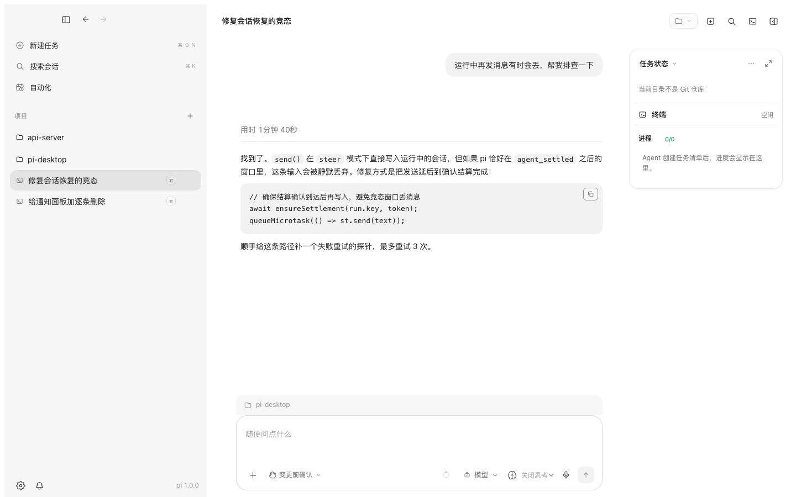
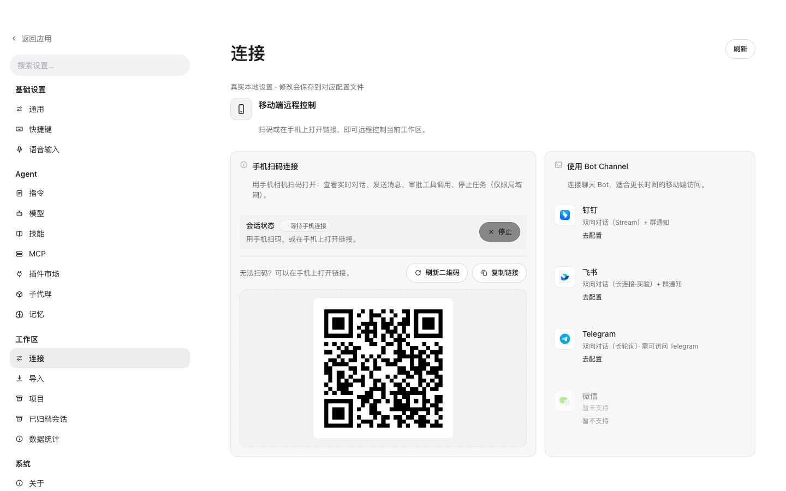

# PI Desktop

[English](./README.md) | **简体中文**

[](https://github.com/xiaoliu10/pi-desktop/releases/latest)
[](./LICENSE)
[](https://www.electronjs.org/)
[](https://www.npmjs.com/package/@earendil-works/pi-coding-agent)

**[pi 编码代理](https://www.npmjs.com/package/@earendil-works/pi-coding-agent)的桌面工作台——过程全程可见，动作逐个确认，掌控权始终在你手里。**

PI Desktop 把本地的 **pi CLI** 装进一个真正的桌面应用：流式对话完整展示代理过程（思考、工具调用、子代理、计划进度），行级变更审查，内置终端，还能用手机远程控制。模型自带——认证留在 pi 内部，前端永不接触。

| 全过程可见的对话 | 手机远程控制 |
| --- | --- |
|  |  |

## 为什么选 PI Desktop

- **过程全部可见。** 思考流式输出、工具调用、子代理活动、计划清单、甚至上下文压缩——代理做的每件事都实时呈现在时间线上，带用时统计和一键复制的代码块。
- **受监督的自治。** 每次文件编辑和命令执行都先询问（仅此一次 / 本会话总是允许 / 拒绝），可按任务切换为自动编辑或完全访问。Review 面板展示相对 Git HEAD 的净变更 diff——绝不把别的会话的改动算作自己的。
- **自愈式运行。** 结算确认丢失、「假运行」卡死——代理 UI 永远转圈的两大经典病因——都被自动检测并恢复，错误直接在会话内渲染，而不是一条死路横幅。
- **不打断心流。** 任务运行中也能编辑已发送的消息（转为排队追问或立即转向）、排队后续输入、随时打断，多个会话跨项目并存。
- **离开电脑也能用。** 扫二维码在局域网内用手机操控当前工作区——看实时对话、审批工具调用、停止任务。或接入 Bot 渠道（钉钉 / 飞书 / Telegram）进行更长时间的会话和群通知。
- **是工作台，不只是聊天框。** 多标签终端（node-pty + xterm）后台保活，计划模式实时清单视图，`@` 文件引用，图片附件，可选语音输入。
- **模型自带。** 供应商配置与认证由 pi 管理：OpenAI、Anthropic、订阅登录，或任意 OpenAI 兼容端点（DeepSeek、Ollama、LM Studio、vLLM、网关）。会话中随时切换模型；语音用独立 ASR 模型。
- **中英双语。** 界面在设置中一键切换，另有明暗主题与字体选择。

## 快速开始

> 前置要求：已在终端安装并验证 [pi CLI](https://www.npmjs.com/package/@earendil-works/pi-coding-agent)（认证与模型由 pi 自身管理）；源码构建需 Node.js ≥ 20。

从 [Releases](https://github.com/xiaoliu10/pi-desktop/releases/latest) 下载对应平台的安装包：

- macOS（Apple Silicon）：`PI.Desktop-<version>-arm64.dmg`
- Windows：`PI.Desktop.Setup.<version>.exe`

或从源码运行：

```bash
pnpm install
pnpm dev        # Vite HMR + Electron
# 或
pnpm build && pnpm start
```

> 若 `pnpm install` 时未下载 Electron 二进制（pnpm 10+ 默认拦截依赖构建脚本），运行 `pnpm rebuild electron`。

### 首次使用

1. 启动 PI Desktop——已有的 CLI 会话自动出现在左侧，按项目分组。
2. 任意会话只读浏览；点击「在桌面端继续」创建接续副本，CLI 原件保持不动。
3. 新建会话，选择项目信任与工具权限模式，挑选模型，发出第一个任务。

已在 macOS 与 Windows 上对 pi **0.85.1 至 1.3.0（不含）** 完成本地验证，内置运行时为 1.2.0。未知版本保持可读但禁止执行，此时回退使用内置运行时。

## 工作原理

```
┌─────────────── PI Desktop (Electron) ───────────────┐
│  渲染进程    React UI：对话 · 审查 · 终端 ·        │
│             计划 · 插件 · 设置 · 远程               │
├────────────── contextBridge（类型化 IPC）────────────┤
│  主进程      会话发现 · 自愈 RPC 看门狗 ·           │
│             权限 · safeStorage                      │
└──────────────────────┬──────────────────────────────┘
                       │ pi --mode rpc
┌──────────────────────▼──────────────────────────────┐
│  pi CLI：代理循环 · 工具 · 供应商 · 认证            │
│  （会话、模型与技能都留在 pi）                      │
└─────────────────────────────────────────────────────┘
```

PI Desktop 通过 pi 的 RPC 模式驱动本地 pi。CLI 会话从磁盘发现并实时跟随，不做导入也不复制。桌面设置只存路径与界面偏好——API key 与订阅凭证永远不离开 pi。

## 功能一览

- **CLI 会话自动出现**——按 cwd 分组、跟随磁盘历史；接续副本保证原件只读。
- **逐动作工具确认**——专用 pi 扩展实现允许 / 拒绝 / 取消对话框，支持会话级记忆授权；权限模式在输入框随时切换（这是应用层确认，不是操作系统沙箱）。
- **真实审查**——Review 面板聚合会话内文件变更的净 diff（行级），改动一目了然。
- **内置终端**——顶栏开关的多标签终端面板；会话在后台保活。
- **计划模式**——代理执行时计划文档与清单进度实时渲染，支持快照回看与一键「执行计划」。
- **子代理**——本地定义子代理；它们作为独立 pi 会话运行，活动卡片实时嵌入对话。
- **MCP**——stdio 与 Streamable HTTP 服务器向 pi 注册工具，设置界面统一管理。
- **插件与技能市场**——统一页面发现、安装、管理 pi 资源（指令、技能、扩展）。
- **记忆**——经 pi-memory 扩展可选启用长期/项目记忆，设置中可浏览可编辑。
- **去重通知**——队列、转向、结算事件只提醒一次，绝不刷屏。
- **语音输入**——云端 ASR（OpenAI 转写端点或 Chat 多模态网关，404 自动回退），转写只追加到输入框、绝不自动发送。配置细节见[语音输入配置](./docs/voice-input.md)。
- **双语界面与主题**——中英一键切换，明暗主题，字体可选。

## 📅 最近版本变化

<table>
<thead><tr><th>版本</th><th>发布内容</th></tr></thead>
<tbody>
<tr><td><strong>0.1.57</strong></td><td><ul><li>内置 pi 升至 1.6.1。如果你之前开启了缓存未命中提示，用 1.6.1 保存设置后退回 1.6.0，需要手动重新开启该提示。</li><li>项目侧栏折叠后，聊天区收回宽度。隧道重连后会清除之前的错误提示。</li></ul></td></tr>
<tr><td><strong>0.1.56</strong></td><td><ul><li><strong>内置 pi 运行时升级到 1.6.0</strong>：OpenAI/Azure/Codex 提供商新增 GPT-6.2 Astra/Sol 模型，find 工具路径模式改为相对搜索目录解析，本机 CLI 兼容窗口放宽到接受本机安装的 pi 1.6.x；上游扩展 API 变更不影响 Desktop 自带扩展。</li><li><strong>macOS Dock 角标按会话计数而不是按完成次数</strong>：每个有完成结果的后台会话只计一次，回到应用前不累加——同一会话完成多轮不再把数字刷高。</li><li><strong>发送技能命令只显示一条用户消息</strong>：运行中和刷新后的历史都只保留一个气泡和一个可展开的技能标记，不再重复。</li></ul></td></tr><tr><td><strong>0.1.55</strong></td><td><ul><li><strong>运行中任务不再把技能全文摊在对话里</strong>：发送 <code>/skill</code> 命令后，pi 会在历史刷新确认前回推展开的技能全文，这个窗口此前会把整页 SKILL.md 以原始 XML 刷屏（折叠摘要只在重新打开会话后出现）。运行中的气泡现在与落盘历史同样折叠成一行摘要（点开可查），只保留你的指令可见。</li></ul></td></tr><tr><td><strong>0.1.54</strong></td><td><ul><li><strong>大窗口下工作面板可以拖得宽得多</strong>：原固定 700px 上限导致桌面版网页（min-width 1000px+）即使在 1920 宽窗口里也横向溢出；上限改为随窗口走（<code>max(700, 窗口宽的 60%)</code>），窗口缩小时自动回钳。</li><li><strong>隧道失败现在显示真实原因</strong>，不再永远停在「连接 relay 中」——relay 拒绝（如服务器重新部署后 key 失效）会显示在隧道状态详情里，不再静默无限重试。</li><li><strong>宿主主会话删除后，子代理会话不再漏进侧栏</strong>：删主会话只删文件、pi-subagents 运行目录仍在磁盘上；父会话推断现在即使宿主文件缺失也能凭 <code>run-N</code> 布局认亲，孤儿子会话保持隐藏。</li></ul></td></tr><tr><td><strong>0.1.53</strong></td><td><ul><li><strong>任务运行中侧栏菊花不再失明</strong>：运行开始事件丢失时，会话此前会整回合卡在「空闲」态（无菊花、计时与停止失效），而 agent 实际一直在工作。看门狗现在双向对账——转写仍在增长的 idle 会话会向 pi 核实并自动拉直为运行中；真空闲会话绝不误翻。</li></ul></td></tr><tr><td><strong>0.1.52</strong></td><td><ul><li><strong>内置 pi 运行时升级到 1.5.2</strong>：工作目录被移动/删除的会话现在可以分叉到当前目录（恢复时提供 继续/分叉/取消），并修复 <code>/import</code> 重复副本与 OAuth 版本号过期问题；无 breaking change。</li></ul></td></tr><tr><td><strong>0.1.51</strong></td><td><ul><li><strong>从 Finder/程序坞启动后语言服务器诊断恢复正常</strong>：GUI 启动的 app 此前只继承系统最小 PATH，pi-lens 以 <code>env node</code> shebang 拉起的 <code>typescript-language-server</code> 直接失败，每个 TypeScript 文件都提示「LSP 不可用」。现在启动时把磁盘上真实存在的 Homebrew/本地 bin 目录补进 PATH，所有子进程继承。</li></ul></td></tr><tr><td><strong>0.1.50</strong></td><td><ul><li><strong>修复 v0.1.47 起会话无法启动</strong>（"Cannot read properties of null"）：任务清单工具被双注册——Desktop 内置策略扩展与必选共用 npm 包各注册一份。现在装了共用包时内置副本自动让位（包缺失时仍兜底加载），包注册也不会再把同一插件以不同版本写法追加两遍。</li></ul></td></tr><tr><td><strong>0.1.49</strong></td><td><ul><li><strong>子代理内部会话不再成批漏进会话列表</strong>：v0.1.41 起数百个 <code>subagent-code-reviewer-…</code> 以假项目形式挤进侧栏与手机远控——会话 header 里的分支指针不再抵消子代理标记，检测同时覆盖 CLI 项目目录布局。你自己的分支/编辑重发会话保持可见。</li></ul></td></tr><tr><td><strong>0.1.48</strong></td><td><ul><li><strong>内置 pi 升级到 1.5.1</strong>：shell 凭据命令（<code>pi auth login/logout</code>）、空闲期提示缓存保温（两次运行间最长 30 分钟）、Anthropic 消息线程（每次请求只发新消息）以及若干网关兼容开关。上游两条 breaking change 已逐条核对，均不影响 Desktop。</li></ul></td></tr>
</tbody>
</table>

> 仅保留最近版本摘要，完整变更记录见 [CHANGELOG.md](./CHANGELOG.md)。

## 开发

```bash
pnpm install
pnpm dev            # 开发编排（Vite + tsc + Electron）
pnpm typecheck      # 主进程 + 渲染进程
pnpm test           # vitest 单元 + 浏览器测试
pnpm preview:ui     # 纯 Web UI 预览（无 Electron / 模型密钥 / 用户文件）
```

真实进程隔离测试（无外部模型调用）：

```bash
PI_TEST_EXECUTABLE=/opt/homebrew/bin/pi pnpm exec vitest run tests
```

[`docs/`](./docs) 下的开发文档为中文：[RPC 协议基线](./docs/pi-protocol-baseline.md) · [工具权限边界](./docs/pi-permission-boundary.md) · [设置页面实现](./docs/settings-implementation.md) · [Phase 2 交付与验证](./docs/pi-integration-verification.md)。

## 与参考项目的差异

界面形态参考 [vastsa/PI-Desktop](https://github.com/vastsa/PI-Desktop)（LGPL-3.0，未复用代码）。该项目以 Electron 配 Rust 宿主核心；PI Desktop 是聚焦 pi CLI 集成的独立纯 Node 实现：Node 主进程承担宿主核心职责，无需 Rust 工具链。

## 参与贡献

欢迎 Issue 与 PR。请先开 Issue 讨论方案；提交前确保 `pnpm typecheck && pnpm test` 通过。

## 致谢

- [pi coding agent](https://www.npmjs.com/package/@earendil-works/pi-coding-agent)——本工作台驱动的代理内核
- 产品形态与架构思路参考 [vastsa/PI-Desktop](https://github.com/vastsa/PI-Desktop)（LGPL-3.0）；未复用代码
- [Electron](https://www.electronjs.org/) · [React](https://react.dev/) · [Vite](https://vite.dev/) · [zustand](https://zustand.docs.pmnd.rs/) · [react-markdown](https://github.com/remarkjs/react-markdown) · [highlight.js](https://highlightjs.org/)

## 许可证

[Apache License 2.0](./LICENSE) 授权。
